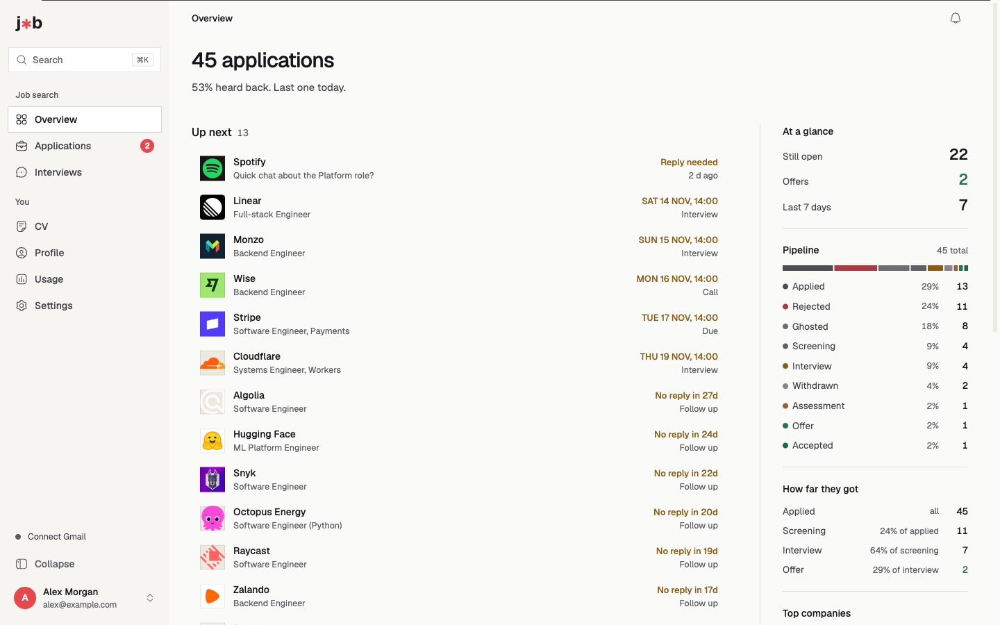
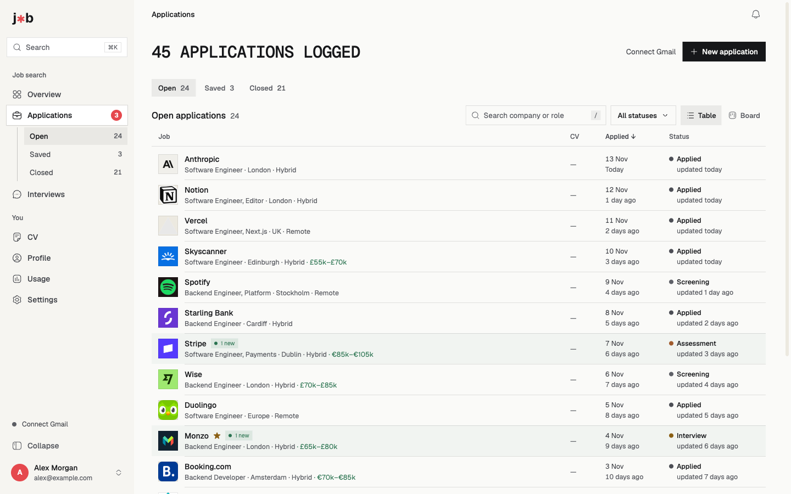
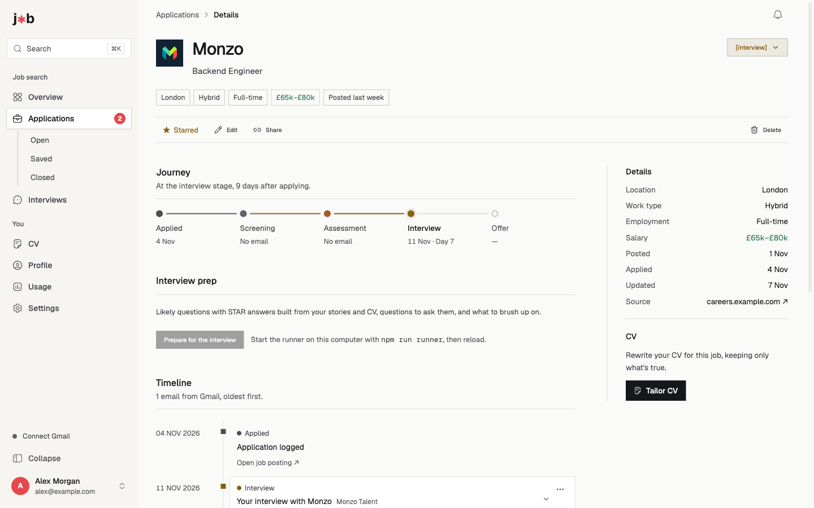
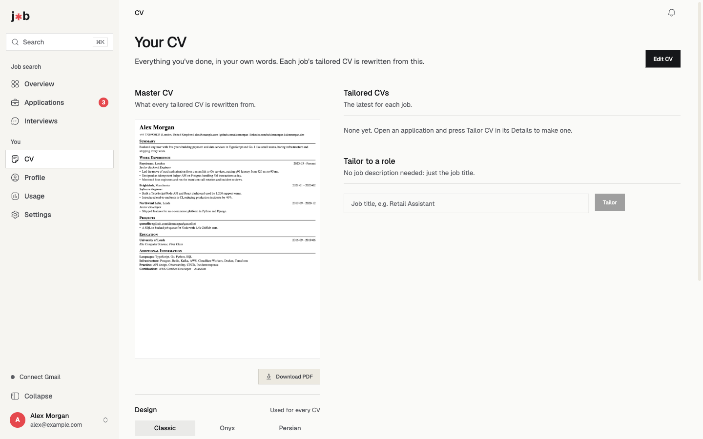

<div align="center">
  <picture>
    <source media="(prefers-color-scheme: dark)" srcset="./images/logo-dark.svg" />
    
  </picture>

  <p><strong>Track every application, read your inbox for you, and tailor your CV to each job.</strong></p>

  <p>
    
    
    
    
  </p>

  <p>
    <a href="#features">Features</a> ·
    <a href="#quick-start">Quick start</a> ·
    <a href="#tailoring-with-claude">Tailoring</a> ·
    <a href="./docs/ARCHITECTURE.md">Architecture</a> ·
    <a href="./extension/README.md">Extension</a>
  </p>

  
</div>

## Features

- **Browser extension.** Save a job from any listing in one click, and autofill application forms from your profile and CV.
- **Gmail sync.** Read-only. Emails are sorted into applied, screening, interview, assessment, offer and rejected, and statuses update themselves. Interview times, deadlines and meeting links land in *Up next*.
- **Private by default.** Only job-related email is kept. Anything else is reduced to its Gmail id and date.
- **Master CV.** Import a PDF or paste text, edit it, and pick from three PDF designs, all checked against how ATS parsers read them.
- **Tailored CVs and cover letters.** Claude proposes edits for each job and code checks every one against your CV, so titles, dates and skills can't be invented. Before rewriting it asks you about skills it can't find, at most six.
- **Analytics.** Funnel, response rate, weekly volume and top companies, all on one overview page.

<div align="center">
  
  
  <br />
  
</div>

## Quick start

You need Node 22+, a Cloudflare account and a Google OAuth client.

```bash
git clone https://github.com/anwaroodin/job-tracker.git
cd job-tracker
npm install
```

**1. Create the Cloudflare resources** and paste their IDs over the `REPLACE_WITH_*` placeholders in `wrangler.jsonc`:

```bash
npx wrangler d1 create job-tracker-db
npx wrangler kv namespace create SESSIONS
npx wrangler r2 bucket create job-tracker-cvs
```

**2. Add Google OAuth.** In [Google Cloud Console](https://console.cloud.google.com/apis/credentials), create an OAuth 2.0 web client with these redirect URIs, then set `APP_URL` in `wrangler.jsonc` to your production origin:

```
http://localhost:5173/api/auth/callback/google
https://<your-worker>.workers.dev/api/auth/callback/google
```

**3. Set secrets.** Locally in `.dev.vars` (see `.dev.vars.example`), in production with `wrangler secret put`:

| Secret | |
| --- | --- |
| `SESSION_SECRET` | Any random string of 32+ bytes |
| `GOOGLE_CLIENT_ID`, `GOOGLE_CLIENT_SECRET` | From step 2 |
| `TYPESAFE_API_KEY` | Optional. Classifies email with [TypeSafe's Jev](https://docs.typesafe.ai) and enables dates, links and reply flags. Without it, built-in keyword rules are used |

**4. Migrate and run:**

```bash
npm run db:migrate:local    # and db:migrate:remote before deploying
npm run dev                 # http://localhost:5173
npm run deploy              # build and deploy to Workers
```

**5. Load the extension.** Load `extension/` unpacked from `chrome://extensions`. Users of a deployed dashboard can download it from its `/extension` page instead. See [extension/README.md](./extension/README.md).

## Tailoring with Claude

Tailoring runs on your own Claude subscription, not an API key. Install and sign in to [Claude Code](https://claude.com/claude-code) on the machine with your browser, then start the local runner:

```bash
npm run runner    # http://127.0.0.1:4317
```

The CV page sends each step to the runner, which runs `claude -p` and shows how much of your 5-hour and weekly limits each run used. If Google's [Antigravity](https://antigravity.google) CLI (`agy`) is installed, the read-only steps (keywords, skill gaps, company research) go to Gemini to save your Claude limits.

<details>
<summary>Runner settings (<code>.env</code>)</summary>

| Variable | Default | Purpose |
| --- | --- | --- |
| `JOB_TRACKER_URL` | none | Your deployed dashboard, so it can use the runner. Comma-separate several |
| `RUNNER_MODEL` | `opus` | Model when the page doesn't pick one |
| `RUNNER_PORT` | `4317` | Port to listen on |
| `RUNNER_ANTIGRAVITY` | on if `agy` is installed | `0` runs every step on Claude |
| `ANTIGRAVITY_MODEL` | `gemini-3.8-flash` | Gemini model for the reading steps |

The runner only accepts requests from `localhost:5173` and `JOB_TRACKER_URL`. It reads your Claude Code login only to ask `api.anthropic.com` for your usage, the way `/usage` does. `agy` runs headless with every tool allowed, so it is sandboxed in an empty temporary folder that is deleted afterwards.

</details>

## Built with

[React Router 8](https://reactrouter.com) · [Cloudflare Workers, D1, KV and R2](https://workers.cloudflare.com) · [Drizzle](https://orm.drizzle.team) · [Better Auth](https://better-auth.com) · [Tailwind CSS v4](https://tailwindcss.com) · [pdfme](https://pdfme.com) · [Claude Code](https://claude.com/claude-code)

The tailoring pipeline is ported from [Resume-Matcher](https://github.com/srbhr/Resume-Matcher) and two CV designs from [Reactive Resume](https://github.com/AmruthPillai/Reactive-Resume). See the `NOTICE.md` files next to that code.

## Contributing

Pull requests are welcome. Read [docs/DEVELOPMENT.md](./docs/DEVELOPMENT.md) for the checks to run and [docs/ARCHITECTURE.md](./docs/ARCHITECTURE.md) for how the code fits together.
